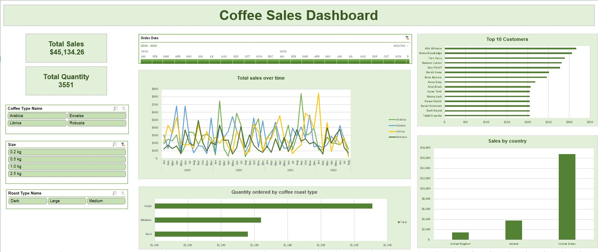

☕ Coffee Sales Dashboard | Excel Data Analytics Project

📌 Project Overview
An interactive Coffee Sales Dashboard built using Microsoft Excel to analyze coffee sales data from 2019 to 2022.

The project focuses on transforming raw data into meaningful business insights through data analysis and interactive visualizations.

🎯 Project Objectives
* Analyze monthly sales trends over time.
* Compare sales performance across different countries.
* Identify the Top 10 Customers.
* Explore product sales by coffee type, size, and roast type.
* Support data-driven business decisions through interactive reporting.

🖥️ Dashboard Preview

📊 Key Analysis Areas
* Total Sales: Analyze overall sales performance.
* Sales Trends: Explore monthly sales patterns over time.
* Sales by Country: Compare sales across different markets.
* Top 10 Customers: Identify the highest-value customers.
* Product Analysis: Examine sales by coffee type, size, and roast type.

🛠️ Tools & Technologies
* Microsoft Excel
* Pivot Tables
* Pivot Charts
* Slicers
* Timeline
* Data Cleaning
* Data Analysis & Visualization

📈 Business Insights & Recommendations
The dashboard provides insights that can help businesses:
* Identify high-performing markets.
* Understand sales fluctuations over time.
* Improve inventory planning.
* Identify valuable customers.
* Develop targeted marketing strategies.

📂 Project Files
File	Description
Dashboard.jpeg	Dashboard preview
Processed Data.xlsx	Cleaned and analysis-ready dataset
Pivot Tables & Charts	Supporting analysis and visualizations

💡 Key Learning Outcomes
Through this project, I strengthened my practical Excel skills, developed my analytical thinking, and gained experience in transforming raw data into interactive dashboards that communicate business insights.

⸻
Author: Mona Mohammed
Field: Data Analytics
Tools: Microsoft Excel
